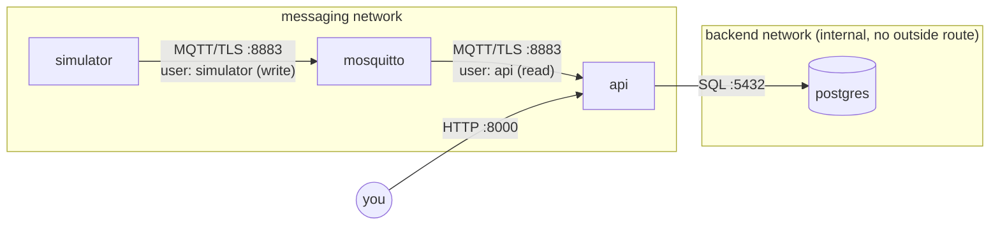
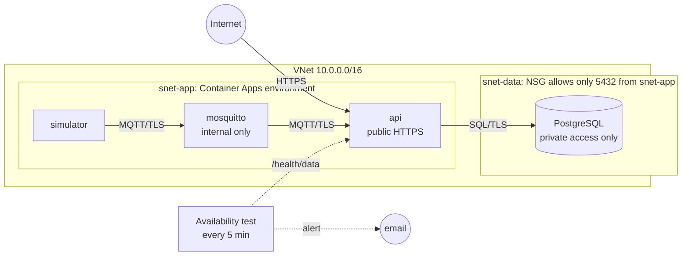
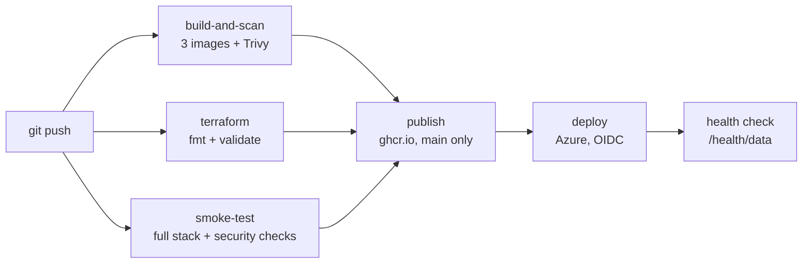

# Architecture

## Data flow

A simulator publishes sensor readings over MQTT (TLS) to a Mosquitto broker.
The API subscribes, stores each reading in PostgreSQL, and serves them over REST.

## Local (Docker Compose)

- Only the API port (8000) is published to the host.
- The database network is `internal: true`: the DB cannot reach or be reached from outside.
- Broker certificates come from `scripts/gen-certs.sh` (private CA, not in git).

## Azure

| Component | Azure service | Notes |
|---|---|---|
| Broker, API, simulator | Container Apps (Consumption) | 1 replica each, images from GHCR |
| Database | PostgreSQL Flexible Server (B1ms) | Delegated subnet, private DNS, no public endpoint |
| Network | VNet + 2 subnets + NSG | DB reachable only from the app subnet |
| Secrets | Container Apps secrets | Generated by Terraform (passwords, TLS keys) |
| Monitoring | Log Analytics, Application Insights, Azure Monitor alerts | Email alerts |
| Terraform state | Storage account (bootstrap) | Private, versioned |
| CI identity | User-assigned managed identity + federated credential | No stored secrets |

## CI/CD pipeline

Design decisions are recorded in [`docs/adr`](adr/).
